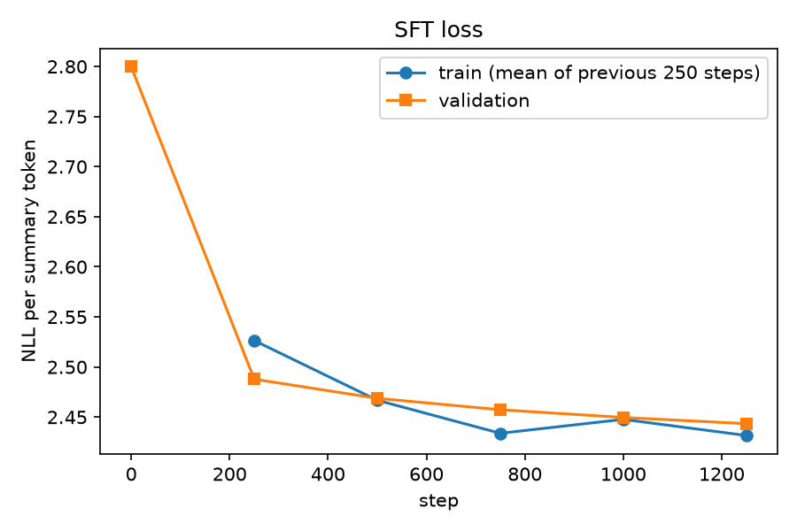
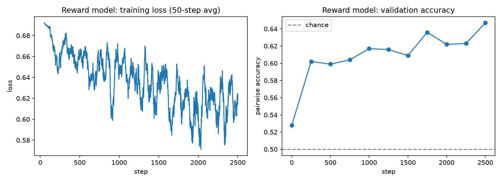
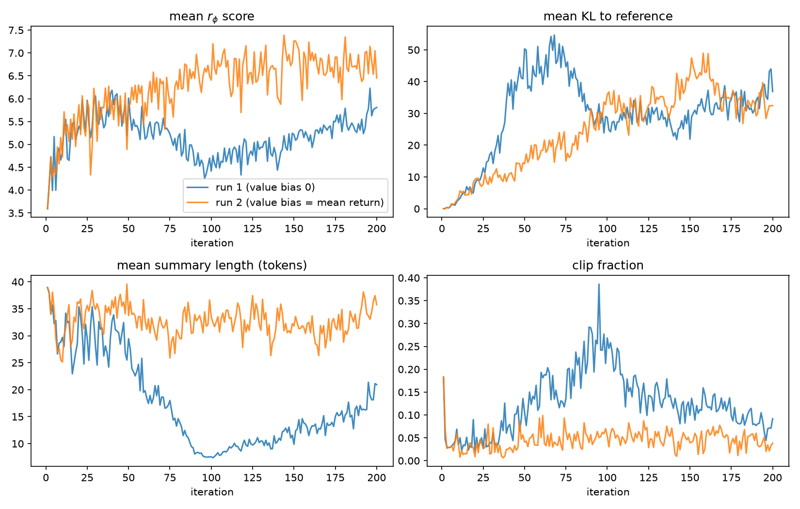
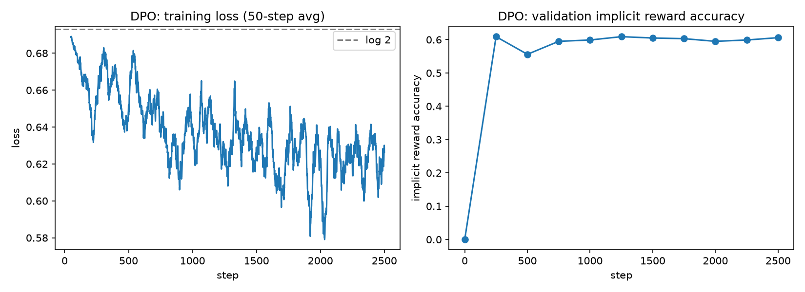
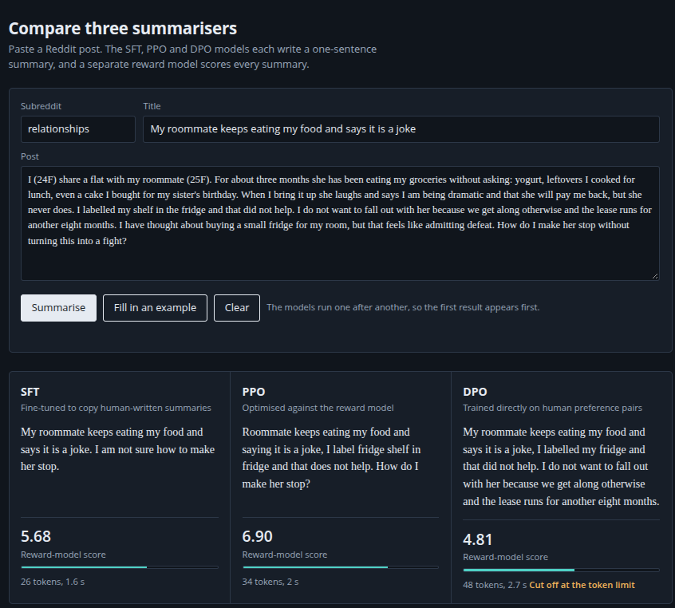

# Learning to Summarize from Human Feedback: SFT, reward model, PPO and DPO

Generative AI, Assignment 03 (Fall 2026), FAST NUCES. Author: Muhammad Ahmad.

This repository reproduces, at small scale, the pipeline of *Learning to Summarize from Human Feedback* (Stiennon et al., 2020). One base model, [HuggingFaceTB/SmolLM2-135M](https://huggingface.co/HuggingFaceTB/SmolLM2-135M) (135M parameters, fully fine-tuned), is taken through four stages, all written by me in plain PyTorch:

| Stage | Model | What it learns |
|---|---|---|
| 1 | SFT policy | to write a one-sentence summary of a Reddit post by imitating human-written ones |
| 2 | Reward model r_phi | to score a summary, from pairs of summaries ranked by humans (Bradley-Terry loss) |
| 3 | PPO policy | to write summaries the reward model scores highly, without drifting far from SFT (KL penalty) |
| 4 | DPO policy | the same goal, directly from the ranked pairs, with no reward model |

No RLHF library is used: no `trl`, `peft`, `trlx`, OpenRLHF, DeepSpeed-Chat, Hugging Face `Trainer` or `AutoModelForSequenceClassification`. Only `torch`, `transformers` (`AutoTokenizer`, `AutoModelForCausalLM`, `model.generate`), `datasets`, `rouge-score`, `numpy` and `matplotlib` are used, plus FastAPI for the front end.

**Links**

- Medium blog: `<add link after publishing>`
- LinkedIn post: `<add link after publishing>`
- Checkpoints (not stored in git):
  - SFT: https://huggingface.co/ehmad7/genai-a3-sft
  - Reward model: https://huggingface.co/ehmad7/genai-a3-reward
  - PPO (run 2, used in all results): https://huggingface.co/ehmad7/genai-a3-ppo-run2
  - PPO (run 1, ablation): https://huggingface.co/ehmad7/genai-a3-ppo-run1
  - DPO: https://huggingface.co/ehmad7/genai-a3-dpo
- Written analysis (Tasks 7.1 to 7.6): [`results/analysis.md`](results/analysis.md)
- Qualitative samples (10 posts): [`results/samples.md`](results/samples.md)

## Main results

All numbers are on 300 held-out posts from the TL;DR test split (greedy decoding, at most 48 new tokens) and come from one run of each method.

**Table 3: final comparison**

| Policy | Mean r_phi | Win rate vs. SFT | KL to SFT | Length (tokens) | ROUGE-L |
|---|---|---|---|---|---|
| SFT | 4.606 | - | 0.000 | 30.5 | 0.2534 |
| PPO | 6.145 | 0.853 | 5.277 | 33.3 | 0.2109 |
| DPO | 3.603 | 0.380 | 3.098 | 45.2 | 0.2307 |

**Table 4: human evaluation (30 posts, blind, random order)**

| | SFT picked | PPO picked | DPO picked |
|---|---|---|---|
| Member 1 | 6 | 15 | 9 |
| Member 2 | 10 | 14 | 6 |
| Agreement between members | 8 / 30 | | |

Member 1 is the author. Member 2 is a friend (not a member of the project) who completed the same blind form. The sheet is in `results/human_eval.csv`. The answer key that maps the letters A/B/C to models is kept out of the repository until the picks were made.

**What the results say (short version; details in `results/analysis.md`)**

- PPO scores highest under the reward model (win rate 85%) and was picked most often by the humans, but its ROUGE-L fell, it ends 85% of its summaries with a question, and during training (temperature 1) it drifted into word salad while the reward kept rising. A higher reward-model score is therefore only a partial signal of a better summary.
- DPO scores lower than SFT under the reward model. 207 of its 300 summaries reach the 48-token limit and are cut off (SFT: 34, PPO: 9). Humans picked DPO about as often as SFT.
- The reward model is 64.7% accurate and favours longer summaries (78.2% accuracy when the chosen summary is longer, 45.9% when it is shorter). DPO's implicit reward shows the same pattern.
- Human agreement was low (8/30, chance is about 10/30) and only 30 posts were rated, so the human results show a trend, not a firm conclusion.

## Data (Table 1)

Both datasets are the OpenAI releases mirrored on Hugging Face ([CarperAI/openai_summarize_tldr](https://huggingface.co/datasets/CarperAI/openai_summarize_tldr), [CarperAI/openai_summarize_comparisons](https://huggingface.co/datasets/CarperAI/openai_summarize_comparisons)). The given starter code in `starter/` (unchanged except for typo fixes when copying from the PDF) cleans them, keeps fixed random subsets (seed 42) and drops posts longer than 448 tokens and summaries longer than 48 tokens. The data contains real Reddit posts, some with mature language; it is treated as research data.

| | |
|---|---|
| SFT train / validation pairs | 20,000 / 500 |
| Preference train / validation pairs | 20,000 / 1,000 |
| Evaluation posts | 300 |
| Prompt length, SFT train (tokens), mean / max | 317.4 / 448 |
| Summary length, SFT train (tokens, including the end-of-sequence token), mean / max | 33.8 / 48 |

## Training (Table 2)

| Stage | Final train loss | Validation metric | Time / GPU |
|---|---|---|---|
| SFT | 2.43 | val. loss 2.4434 | 63.0 min / Colab T4 |
| Reward model | 0.616 | pairwise acc. 0.647 | 102.3 min / Colab T4 |
| PPO (run 2) | 0.102 | final mean r_phi 6.74 | 43.5 min / Kaggle T4 |
| DPO | 0.622 | implicit reward acc. 0.606 | 146.1 min / Kaggle GPU |

Train losses are means over the last 250 optimiser steps (SFT, reward model, DPO). For PPO the loss is the mean of `pg + 0.1 * value - 0.01 * entropy` over the last 10 iterations, and the final mean r_phi is the mean over the last 10 iterations of sampled training rollouts (temperature 1), which is not the same as the greedy evaluation score in Table 3.

Settings (all fixed by the assignment):

| Stage | Settings |
|---|---|
| SFT | AdamW, lr 5e-5, batch 16, 1 epoch (1,250 steps), gradient clipping 1.0, loss = mean NLL of summary tokens only |
| Reward model | SFT body + `nn.Linear(hidden, 1)` on the last non-padding token, Bradley-Terry loss, AdamW, lr 1e-5, batch 8 pairs, 1 epoch |
| PPO | clip 0.2, beta_KL 0.05, c_V 0.1, c_H 0.01, gamma 1, 4 epochs per rollout, AdamW lr 1e-5, gradient clipping 1.0, 16 prompts per rollout, 200 iterations, sampling with temperature 1, top-k 0, top-p 1 |
| DPO | beta 0.1, AdamW, lr 2e-6, batch 8 pairs, 1 epoch (2,500 steps) |

## Figures

1. SFT training and validation loss: `results/fig1_sft.png`
2. Reward-model training loss and validation accuracy: `results/fig2_reward.png`
3. PPO, mean r_phi, KL, length and clip fraction against iteration (run 1 and run 2): `results/fig3_ppo.png`
4. DPO training loss and validation implicit reward accuracy: `results/fig4_dpo.png`
5. Front-end screenshot: `results/fig5_frontend.png`






## Front end

A small FastAPI app (`app/`) loads the SFT, PPO and DPO checkpoints and the reward model. The user pastes a post and gets the three summaries side by side, each with its reward-model score, its length, and a flag when the summary was cut off at the 48-token limit.



To run it (CPU is enough; one summary takes a few seconds per model):

```bash
pip install -r requirements.txt
python app/download_checkpoints.py        # fetches the four checkpoints from Hugging Face into checkpoints/
uvicorn app.main:app --port 8000
# open http://127.0.0.1:8000
```

If the Hugging Face repositories are private, set `HF_TOKEN` first (`export HF_TOKEN=...`). Folders can be changed with the environment variables `SFT_PATH`, `PPO_PATH`, `DPO_PATH` and `RM_PATH`.

## Repository layout

```
starter/               the given files (config, models, data, batching, check_starter), see note above
common.py              token log-probs, summary mask, generation helper
train_sft.py           Task 2
train_reward.py        Task 3 (reward-model class and training)
train_ppo.py           Task 4 (value head, rollout, rewards, returns, PPO loss)
train_dpo.py           Task 5
evaluate.py            Task 6
results/               logs, tables, figures, summaries, human evaluation, analysis.md, samples.md
app/                   FastAPI front end and checkpoint downloader
README.md
```

Helper scripts used for the report (all read from `results/`):

| Script | Purpose |
|---|---|
| `data_stats.py` | Table 1 |
| `check_common.py` | summary-mask check |
| `regen_sft_samples.py` | before/after SFT samples for 5 evaluation posts (`results/sft_samples.json`) |
| `make_figures.py` | Figures 1 to 4 |
| `ppo_summary.py` | PPO log summary and correctness checks |
| `inspect_eval.py`, `make_samples.py`, `fill_why.py` | qualitative samples |
| `make_human_eval.py`, `make_human_eval_form.py`, `score_human_eval.py` | blind human evaluation sheet, form and Table 4 |
| `analysis_reward.py`, `analysis_dpo_vs_rm.py`, `analysis_human_vs_rm.py`, `analysis_length.py` | numbers used in `results/analysis.md` |

## How to reproduce

Training needs a GPU (I used free Colab and Kaggle T4s). Everything below runs from the repository root, except the starter check.

```bash
pip install -r requirements.txt

# Task 1: starter code and data statistics
cd starter && python check_starter.py && cd ..
python data_stats.py                      # Table 1
python check_common.py                    # summary-mask check

# Task 2: SFT  ->  checkpoints/sft
python train_sft.py

# Task 3: reward model  ->  checkpoints/reward   (needs checkpoints/sft)
python train_reward.py

# Task 5: DPO  ->  checkpoints/dpo               (needs checkpoints/sft)
python train_dpo.py --resume

# Task 4: PPO  ->  checkpoints/ppo               (needs checkpoints/sft and checkpoints/reward)
python train_ppo.py --resume --log_path results/ppo_run2_log.json

# Task 6: evaluation on the 300 posts
python evaluate.py

# figures and analysis helpers
python make_figures.py
```

Paths and options can be changed with flags (for example `--sft`, `--reward`, `--ckpt_dir`, `--log_path`). `--resume` continues from the periodic checkpoint after a disconnect. The three long runs write their logs to `results/`.

PPO run 1 (ablation) was produced with the version of `train_ppo.py` at commit `7852fbf`, before the value-head initialisation described below was added in commit `8f714ed`. To reproduce run 1, check out that commit.

## Correctness checks

Each check below was run on the real data and checkpoints.

**SFT mask:** decoding the tokens where `summary_mask` is 1 gives exactly the summary text followed by the end-of-sequence token (full output in `results/check_summary_mask.txt`):

```
[0] masked tokens decoded: ' Me and my sister were going to the park, put my sister in her carseat, left her there for thirty minutes, mom saved her from my ignorance, got grounded for a month.<|endoftext|>'
[0] mask sum = 39 | summary tokens (with EOS) = 39
...
All checks passed: mask is 1 exactly on summary tokens (+ EOS).
```

**Frozen models:** every parameter of the reference model and of the reward model has `requires_grad = False` during PPO and DPO (asserted in `train_ppo.py` and `train_dpo.py`):

```
frozen check: reference and reward model have requires_grad=False on all parameters   (PPO)
frozen check: reference has requires_grad=False on all parameters                      (DPO)
```

**PPO, first iteration:** the KL to the reference is 0 because the policy still equals SFT.

**PPO, every iteration:** in the first of the K = 4 epochs, r_t(theta) = 1 for every token and the clip fraction is 0. In run 2 this held in all 200 iterations (`python ppo_summary.py results/ppo_run2_log.json`):

```
CHECK iter 1: KL=0.000000 | epoch-1 max|ratio-1|=0.00e+00 | epoch-1 clip fraction=0.0000
max epoch-1 |ratio-1| over all iters: 0.00e+00
max epoch-1 clip fraction over all iters: 0.0
```

**DPO, first step:** the loss equals log 2:

```
first-step loss = 0.69315  (log 2 = 0.69315)
```

**Padding:** prompts for `generate` are left-padded. The reward model reads the hidden state of the last real token, found with the attention mask and not with `input_ids != pad_token_id` (the pad token is the end-of-sequence token). Adding padding does not change the reward:

```
padding check: r(no pad)=0.95474  r(+7 pad)=0.95474
```

## Implementation notes and deviations

These are the places where I went beyond or differ from the assignment text:

- **Gradient accumulation.** To fit a 15 GB T4, batches are split into micro-batches whose gradients are accumulated before one optimiser step, so the effective batch size is the one in the assignment (16 sequences for SFT, 8 pairs for the reward model and DPO). The assignment allows this for PPO; I used it everywhere.
- **PPO value-head initialisation (not in the assignment).** In run 1 the value head started at zero, the value loss was 15 to 28 in the early iterations, and the summary length collapsed to about 8 tokens around iteration 100. In run 2 (used for all results) the bias of the value head is set once to the mean return of a first rollout, before training. All fixed PPO settings are unchanged. Run 1 is kept as an ablation in the figures and in `results/ppo_run1_log.json`.
- **PPO sequence layout.** After sampling, each prompt and response is rebuilt as a right-padded sequence so that the summary mask and the reward model see the same layout as in their training. Log-probabilities and values are computed only at the generated positions, which keeps memory low.
- **Precision.** SFT ran with the library's default bf16 weights; the reward model, PPO and DPO were run in fp32 because the learning rates are small. The saved SFT checkpoint is therefore bf16 (269 MB); the others are fp32 (538 MB).
- **Lost SFT step log.** The per-step SFT training loss was lost when a Colab runtime disconnected. `results/sft_log.json` was reconstructed from the console output (six evaluation points), so Figure 1 has six points.
- **Hardware.** SFT and the reward model ran on Colab, PPO and DPO on Kaggle, because of usage limits. All runs use seed 42.
- **Reward-model checkpoint format.** The reward model is stored as a plain `state_dict` (`reward_model.pt`), loaded with `train_reward.load_reward_model`, because the assignment only allows `AutoTokenizer` and `AutoModelForCausalLM` from `transformers`.

## Limitations

One seed per run; 30 human-rated posts with low agreement (8/30); a reward model that is only 64.7% accurate and length-biased; and several explanations in `results/analysis.md` (DPO truncation, the length bias in DPO, the cause of the run-1 collapse) are hypotheses that I did not test with extra runs.
